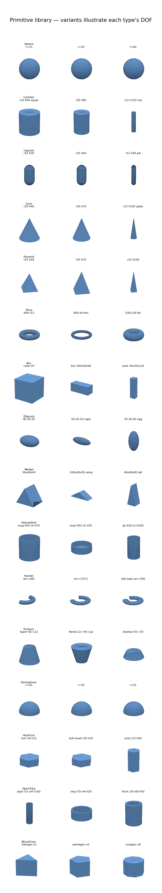

# Robotic Object Generator

**Generative 3D Object Modeling for Robust Robot Manipulation in ROS 2**: accepted and
presented at IEEE ICARM 2026 (Paris, 21–23 July 2026; proceedings forthcoming).
Project page: <https://gen3d-research.github.io/3d_generator/>

A lightweight, dataset-free framework for generating diverse 3D objects suitable for robotic
manipulation. Objects are scored on robotics-relevant criteria (stability, graspability, size),
and the generator learns to produce high-quality objects with the Cross-Entropy Method.

> **Which code is which.** `main` is **v2**, the post-paper system (19 primitive types, 105
> archetypes, connected-by-construction sampling, mesh-union inertia, grasp re-ranking,
> per-primitive collision export, collision-aware MoveIt, MuJoCo cross-simulator evaluation).
> The exact code behind the ICARM paper is on the branch **`legacy/v1-icarm`**;
> `generator.paper_repro_generator()` reproduces the v1 configuration from v2 code. What
> changed and why is in [`DISCREPANCIES.md`](DISCREPANCIES.md) and
> [`docs/SIM_NOTES.md`](docs/SIM_NOTES.md).

## Key Features

- **No external datasets required**: self-contained training loop
- **No neural networks/LLMs**: pure optimization (fast, interpretable)
- **Robotics-first scoring**: stability, graspability, feasible size
- **Direct ROS 2 integration**: exports URDF/SDF with physical properties
- **Lightweight**: generation runs on CPU, no GPU needed

## Installation

The generator targets Python 3.10+ (developed on 3.12). Keep the virtual environment outside
the repo so build artefacts don't churn it:

```bash
python3 -m venv ~/venv/3d_cem          # one-off
source ~/venv/3d_cem/bin/activate      # every shell
pip install -r requirements.txt        # numpy, scipy, trimesh, manifold3d, cma, mujoco, coacd, ...
```

There is no package install: every command below runs **from `3d_generator/`**. The CLI and
the scripts put `src/` on `sys.path` themselves, and the modules import each other flat
(`from generator import ...`).

Tests (170, about 10 s). Clear `PYTHONPATH` so a sourced ROS 2 doesn't inject pytest plugins:

```bash
env -u PYTHONPATH python -m pytest
```

The ROS 2 evaluation package (MoveIt 2 + Gazebo Harmonic, needs ROS 2 **Jazzy**) builds
separately:

```bash
source /opt/ros/jazzy/setup.bash
cd ros2_ws && colcon build && cd ..
source ros2_ws/install/setup.bash
```

It needs `moveit_py`, `moveit_resources_panda_moveit_config`, `ros_gz_sim`, `gz_ros2_control`
and `parallel_gripper_controller` from apt (see `ros2_ws/src/generated_objects_eval/package.xml`).

## Quick Start

### Command line

```bash
python src/main.py demo                                      # ~30 s sanity check
python src/main.py generate -n 100 -o output/objects --train --iterations 50
python src/main.py archetypes -o output/archetypes           # all 105 archetypes -> URDF/SDF
python src/main.py score path/to/mesh.obj                    # score an arbitrary mesh (bbox proxy)
```

### Python API

```python
import sys; sys.path.insert(0, "src")      # from 3d_generator/
from generator import RoboticObjectGenerator

gen = RoboticObjectGenerator()
gen.train(n_iterations=30, verbose=True)
objects = gen.generate(n=50)
gen.export_all(objects, "output/objects")  # URDF + SDF + meshes + metadata
gen.save("trained_generator.json")
```

The repo can produce objects **12 different ways** (archetype-raw, archetype-CEM, random,
free CEM, constrained, stability-repair, seeded, Pareto, targeted-size, text2geometry, …).
Each one as a copy-paste command is in
[**`docs/GENERATION_PATHS.md` → "Generate with each path"**](docs/GENERATION_PATHS.md), and the
end-to-end *generate → visualize → drop test → pick-and-place* walkthrough is in
[**`GUIDE.md`**](GUIDE.md).

### Visualize the shape library

All renderers are headless and write PNGs under `docs/gallery/`:

```bash
python scripts/render_primitives.py            # the 19 primitive types + their DOF
python scripts/render_gallery.py               # all 105 archetypes + a trained-CEM sample sheet
python scripts/gen_strategies.py --strategy all  # constrained generation sweeps (single-type, pairs, symmetric, …)
python scripts/render_archetype_varieties.py --subset --combined  # CEM-trained varieties per archetype
```

## Evaluation

Five generators (CEM, Fixed CAD, CMA-ES, random search, GA) are compared on metrics computed
by code paths independent of the CEM's own score. `REPRODUCE.md` walks through every cell of
the paper's Table I. The multi-seed pipeline:

```bash
# On a shared machine, isolate the ROS graph and gz transport (these are the defaults):
export ROS_DOMAIN_ID=23 GZ_PARTITION=gen3d

# Per seed: manifest (5 methods x top-25 objects + grasps) -> unified Python eval
# (force-closure grasp synthesis, diversity) -> MoveIt 2 planning -> Gazebo drop test.
# Each stage is skipped when its JSON exists; OUT_ROOT picks a fresh result set.
OUT_ROOT=output/my_study bash scripts/run_multi_seed.sh 42 43 44

# Aggregate: mean, sample std, 95% t-CI, paired Wilcoxon CEM vs best rival.
python scripts/aggregate_seeds.py 42 43 44 --root output/my_study --out output/my_study/aggregated.json

# Cross-simulator check in MuJoCo (no ROS): drop test + physics pick-and-lift, seconds per seed.
python scripts/run_mujoco_eval.py --root output/my_study --seeds 42 43 44
python scripts/run_mujoco_eval.py --root output/my_study --seeds 42 43 44 --collision coacd
```

`run_multi_seed.sh` kills only processes carrying its own `GZ_PARTITION`, and calls
`/opt/ros/$ROS_DISTRO/bin/ros2` even if another `ros2` is earlier on `PATH`. A seed takes about
7 min of Python (the five methods' 1,500-object budgets) plus a few minutes of MoveIt and
Gazebo. Seeds can run their Python stages in parallel; the ROS stages share one domain, so run
those one seed at a time.

Other entry points:

```bash
python3 scripts/run_scale_experiment.py -n 10000 --iterations 30 --train   # archetype study (~1 h)
ros2 launch generated_objects_eval visual_demo.launch.py use_gz_control:=true  # pick-and-place demo (GUI)
```

Two knobs control how many objects flow through the pipeline: `--top-k K` on
`build_eval_manifest.py` (objects per method in the manifest) and `--budget N` (candidates each
method scores before selecting elites).

**MuJoCo cross-simulator evaluation** ([`src/mujoco_eval.py`](src/mujoco_eval.py)) rebuilds
each exported object from its SDF and runs (1) a drop test that mirrors the Gazebo one (5 cm drop,
5° tilt, 2 s settle, tilt < 25°, drift < 5 cm), reported with per-object agreement against
Gazebo, and (2) a physics pick-and-lift: a free-floating Panda-like parallel-jaw gripper walks
the planner's ranked grasps, skips infeasible ones (too wide, approaching from below, hand
already intersecting the table at the pre-grasp), executes up to three, and counts a success
when the object rises at least 7 cm with both pads still touching it (μ = 0.5, 20 N per finger).
`--collision sdf` uses the exported collision set (what Gazebo sees, with concave primitives
hulled); `--collision coacd` uses a CoACD decomposition of the true mesh.

## How It Works

### 1. Parametric Object Representation
Objects are compositions of **19 primitive types** (the 9 base shapes plus the audit/roadmap
additions through the v2.8 L/U/T/I extrusion) with rigid transforms. This keeps generation fast
and interpretable. See [**Shape Library & Limitations**](#shape-library--limitations) below for
the full gallery, parameters, and a fidelity audit.

### 2. Constraint-Based Scoring
Each object is scored on manipulation-relevant criteria:

| Criterion | Description |
|-----------|-------------|
| **Size feasibility** | Fits gripper workspace (2-15 cm) |
| **Static stability** | COM within support polygon |
| **Graspability** | Has antipodal surface pairs for parallel-jaw grasping |
| **Mesh validity** | Watertight, no degeneracies |
| **Complexity** | Bounded triangle count for fast collision checking |

### 3. Cross-Entropy Method (CEM)
The generator learns without external data:
1. Sample N candidate objects from current distribution
2. Score each on manipulation criteria
3. Keep top 20% (elite samples)
4. Update distribution to maximize likelihood of elites
5. Repeat

After ~30-50 iterations, the generator produces consistently high-quality objects.

### 4. URDF/SDF Export
Generated objects are exported with:
- a visual mesh (the boolean union of the primitives) and a single-mesh collision fallback
- one collision element per primitive (native box / cylinder / sphere; a convex-hull piece for
  the other types), so Gazebo's ODE collider never meets trimesh–trimesh pairs
- mass, COM and inertia from the union solid (overlap-aware), falling back to per-primitive
  analytic tensors when no CSG backend is available
- surface properties (friction, restitution), ready for Gazebo and MoveIt

## Shape Library & Limitations

The generator assembles objects from **19 primitive types**. Each row below varies
one type to show its **degrees of freedom** (DOF), meaning how many independent shape
parameters it has (sphere = 1, box = 3):



| Primitive | DOF | Parameters | clamp range (m) |
|---|---|---|---|
| box | 3 | dx, dy, dz | 0.01 – 0.15 |
| cylinder | 2 | radius, height | r 0.005–0.08, h 0.01–0.15 |
| sphere | 1 | radius | 0.01 – 0.08 |
| capsule | 2 | radius, height | r 0.005–0.05, h 0.01–0.12 |
| cone | 2 | radius, height | r 0.008–0.07, h 0.02–0.14 |
| pyramid | 2 | radius, height | r 0.01–0.08, h 0.02–0.14 |
| torus | 2 | major, minor | R 0.025–0.08, r 0.005–0.02 |
| ellipsoid | 3 | rx, ry, rz | 0.01 – 0.08 |
| wedge | 3 | width, depth, height | 0.015 – 0.14 |
| **hollow_shell** ✨ | 4 | outer, wall, height, floor | open-top container body |
| **handle** ✨ | 4 | major, tube_a, tube_b, arc | C-shaped elliptical-tube arc |
| **frustum** ✨ | 3 | r_bot, r_top, height | flared / truncated cone |
| **hemisphere** ✨ | 1 | radius | dome / scoop |
| **hex_prism** ✨ | 2 | radius, height | hex nut / bolt head |
| **open_tube** ✨ | 3 | outer, wall, height | pipe / ring (open both ends) |
| **ngon_prism** ✨ | 3 | n_sides, radius, height | triangular…octagonal prism |
| **rounded_box** ✨ | 4 | dx, dy, dz, fillet | filleted phone / tablet / soap bar |
| **gear_prism** ✨ | 4 | n_teeth, r_outer, r_inner, height | gear / cog / star knob |
| **extruded_profile** ✨ | 5 | kind, w, h, t, length | L / U / T / I structural member |

### Faked shapes → missing primitives

Most archetypes are **faithful** (boxes/bars/plates/posts and their assemblies).
The audit found that every **container, handle, taper, and dome was faked** with a
solid or full-ring stand-in: a mug body was a *solid* cylinder, a cup handle a
*full* torus. **v2.2 added `hollow_shell` + `handle`** and **v2.3 added `frustum`
+ `hemisphere`**, so mug/cup/pot/teapot/jar/bowl are now real hollow vessels with
C-handles, and plunger/trophy/ladle have proper flared cups and dome scoops (see
the archetype gallery). All five audit-proposed primitives are now built.

| Faked feature | Old stand-in | Archetypes | Primitive | Status |
|---|---|---|---|---|
| open container | solid cylinder / ellipsoid | mug, cup, pot, jar, bowl | **Hollow shell** | ✅ built |
| C-shaped handle | full torus / straight cylinder | mug, cup, pot, teapot | **Handle / arc** | ✅ built |
| flared / truncated taper | solid cone (apex) | plunger, trophy, buckets | **Frustum** | ✅ built |
| dome / scoop | solid sphere / capsule | ladle, lids, domes | **Hemisphere** | ✅ built |
| hex fastener | round cylinder / pyramid | nut, bolt | **Hex prism** | ✅ built |

Known limitation: the exported collision set convex-hulls the concave primitives (hollow shell,
open tube, torus, handle, gear, L/U/T/I profile), so in Gazebo a cup is solid and a finger cannot
enter it. MoveIt gets the true mesh; the MuJoCo evaluator can use a CoACD decomposition.

➡️ **Full gallery, math, per-type limitations, accepted/rejected/optimized sample
galleries, and design sketches for the proposed primitives are in
[`docs/PRIMITIVES.md`](docs/PRIMITIVES.md).**

## Project Structure

```
3d_generator/
├── src/                      # Core Python sources (flat modules, no package install)
│   ├── primitives.py            geometric primitives (19 types) + CompositeObject
│   ├── archetypes.py            105 hand-written archetype factories (registry)
│   ├── scoring.py               constraint-based scoring (+ graspability/stability gates)
│   ├── cem.py                   Cross-Entropy Method optimizer (+ type masks, seeding)
│   ├── stability_repair.py      re-orient objects onto their stable resting pose
│   ├── pareto.py                non-dominated (Pareto) selection over objectives
│   ├── text2gen.py              text-conditioned front-end (prompt -> generator config)
│   ├── export.py                URDF/SDF exporter
│   ├── generator.py             top-level generator facade
│   ├── baselines.py             CMA-ES / GA / Random / Fixed-CAD baselines
│   ├── grasp_planner.py         force-closure grasp synthesiser
│   ├── mujoco_eval.py           MuJoCo drop test + physics pick-and-lift
│   ├── diversity.py             diversity proxies
│   ├── archetype_cem.py         per-archetype CEM track
│   └── main.py                  CLI entry point
├── scripts/                  # Reproduction + analysis scripts (selection)
│   ├── build_eval_manifest.py      5-method eval manifest (objects + grasps)
│   ├── build_archetype_manifest.py N variants per archetype -> ROS 2 manifest
│   ├── build_path_manifest.py      one generation path (④,⑥-⑫) -> ROS 2 manifest
│   ├── run_unified_eval.py / run_multi_seed.sh / aggregate_seeds.py
│   ├── run_mujoco_eval.py          MuJoCo cross-simulator eval over seed dirs
│   ├── run_drop_test_chunked.sh    crash-resilient Gazebo drop test at scale
│   ├── patch_sdf_collision.py      contact/friction patch for finger grasps
│   ├── gen_strategies.py           constrained generation sweeps (galleries)
│   ├── render_*.py                 primitive/archetype/variant galleries
│   ├── replot_paper_figures.py     ICARM camera-ready figures at 8 pt
│   └── archetype_tour.py / emit_latex_table.py / make_clean_diff.py
├── tests/                    # pytest suite (v2 invariants + MuJoCo evaluator)
├── ros2_ws/src/generated_objects_eval/   # ROS 2 evaluation package (MoveIt 2 + Gazebo)
├── docs/                                 # Project page + PRIMITIVES/ROADMAP/GENERATION_PATHS/SIM_NOTES
├── GUIDE.md                              # generate -> visualize -> drop/pick walkthrough
├── README.md / REPRODUCE.md / DEMO.md / DISCREPANCIES.md
├── requirements.txt
└── reproduce_paper.sh
```

## Output Format

Each exported object:
```
object_0000/
├── object_0000.urdf           # robot description (MoveIt)
├── object_0000.sdf            # Gazebo model (per-primitive collisions)
├── object_0000_metadata.yaml  # primitives, mass properties, scores
└── meshes/
    ├── object_0000_visual.obj     # union mesh
    ├── object_0000_collision.obj  # single-mesh collision (fallback)
    └── object_0000_col<i>.obj     # convex-hull collision piece for primitive i (non-native types)
```

## Integration with ROS 2

### Loading in Gazebo (Harmonic)

Start a world and spawn an exported SDF with `ros_gz_sim`:

```bash
gz sim -r empty.sdf &
ros2 run ros_gz_sim create -file "$PWD/output/objects/object_0000/object_0000.sdf" \
    -name object_0000 -x 0.5 -y 0 -z 0.1
```

The evaluation package ships its own world (`ros2 launch generated_objects_eval
stability_world.launch.py`, a Panda table at 0.4 m) and the drop-test node
`gazebo_stability_eval --manifest <manifest.json> --out <result.json>`.

### Using with MoveIt 2

The demo driver (`ros2_ws/src/generated_objects_eval/generated_objects_eval/demo_plan_driver.py`)
shows the recommended pattern under `moveit_py` 2.12.x: publish a
`moveit_msgs/PlanningScene` *diff* on the `/planning_scene` topic instead of
calling `moveit_py.PlanningSceneInterface.apply_collision_object` (which
segfaults in 2.12.x on Jazzy). The driver uses this to add the table and the object's true
mesh as CollisionObjects so RRTConnect plans around them.

```python
from moveit_msgs.msg import CollisionObject, PlanningScene, PlanningSceneWorld
from shape_msgs.msg import SolidPrimitive

co = CollisionObject()
co.header.frame_id = "panda_link0"
co.id = "demo_table"
co.operation = CollisionObject.ADD
prim = SolidPrimitive(type=SolidPrimitive.BOX, dimensions=[0.8, 0.8, 0.4])
co.primitives = [prim]
co.primitive_poses = [table_pose]   # geometry_msgs/Pose at (0.5, 0, 0.2)

scene = PlanningScene(is_diff=True,
                      world=PlanningSceneWorld(collision_objects=[co]))
planning_scene_pub.publish(scene)   # TRANSIENT_LOCAL latched publisher
```

## Scoring Details

### Graspability Proxy
We estimate parallel-jaw graspability without a grasp database by counting antipodal surface pairs:
- Sample points on surface with normals
- Find pairs where: normals nearly opposite (n₁·n₂ < -0.9) AND distance within gripper range
- More valid pairs → higher graspability score

### Stability Proxy
- Compute support polygon (convex hull of ground-contact vertices)
- Project center of mass onto ground plane
- Score = distance from COM to polygon boundary (larger = more stable)

## Citation

If you use this in research, please cite (proceedings forthcoming):
```bibtex
@inproceedings{albatati2026generative3d,
  title     = {Generative 3D Object Modeling for Robust Robot Manipulation in ROS 2},
  author    = {Al-Batati, Abdulrahman S. and Alhabashi, Yasser and Gabr, Khaled
               and Sibaee, Serry and Abdelkader, Mohamed and Boulila, Wadii},
  booktitle = {Proceedings of the 2026 International Conference on Advanced
               Robotics and Mechatronics (ICARM)},
  address   = {Paris, France},
  year      = {2026},
  note      = {Accepted and presented; proceedings forthcoming},
}
```

## License

MIT License
